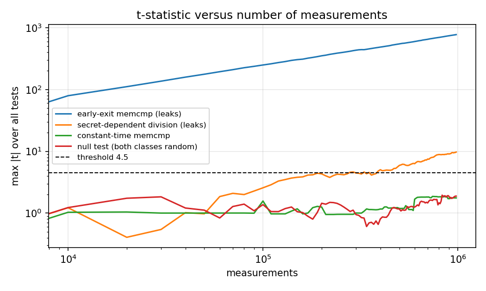

# ct-audit

A small timing-leak test bench in C. It applies a dudect-style statistical test
(fixed-versus-random inputs, Welch's t-test) to a handful of targets: some are known
to leak, some are written not to, and some are post-quantum reference implementations
(ML-KEM-768 and ML-DSA-65 from PQClean). The goal is to practise the method, to see how
it behaves across compilers and optimisation levels, and to record honestly what it
does and does not show.

It does not claim any new result. Testing ML-KEM implementations with dudect-like tools
has been done before; see the references.

## Method

For each target, the harness draws a class at random for every measurement (class 0:
a fixed input, class 1: a random input), prepares the inputs for a batch of 1000
measurements, then times the operation under test with `rdtsc` (serialised with
`lfence`). Preparing inputs for the whole batch before timing matters: preparing an
input right before its timed call left class-dependent state in the timed window and
produced false positives on code that is constant time (see "Notes on the harness").

Seven t-statistics are computed per target:

* the raw timings;
* five percentile-cropped versions (measurements above the 50th, 75th, 90th, 95th and
  99th percentile of a calibration sample are dropped), to limit the effect of
  outliers;
* a second-order test on the centred square of the timings.

The first 20 000 measurements of each run only set the crop thresholds and are not
used in the statistics. A target is flagged when the largest |t| exceeds 4.5 and also
exceeds a Bonferroni-corrected threshold over all targets and tests of the matrix
(family-wise alpha = 0.001; with 17 targets x 7 tests = 119 tests the corrected
threshold is below 4.5, so 4.5 applies). The PRNG is a seedable xorshift64*; every cell
of the matrix is run with seeds 1, 2 and 3 and the range of max |t| is reported.

## Targets

| target | what it is | expectation |
|---|---|---|
| `memcmp_early_exit` | 32-byte comparison that returns at the first difference | leak (positive control) |
| `memcmp_constant_time` | same comparison, accumulating XOR | no leak |
| `div_q3329_secret` | secret-dependent division by 3329, in the style of KyberSlash (volatile divisor so a real `div` is emitted; fixed class = all-zero coefficients) | leak (positive control) |
| `div_free_reciprocal` | same computation using a multiplication by a reciprocal | no leak |
| `null_both_random` | both classes random | no leak (checks the harness) |
| `mlkem768_dec`, `mlkem768_enc` | PQClean `ml-kem-768/clean`; decapsulation with a fixed vs fresh valid ciphertexts, encapsulation with a fixed vs random message | none expected |
| `mldsa65_sign` | PQClean `ml-dsa-65/clean`, fixed vs random message | variability expected (rejection sampling) |
| `aes128_sbox_table` | AES-128 with a 256-byte S-box lookup, fixed vs random plaintext | see findings |
| `aes128_bitsliced` | PQClean bitsliced AES-128 | none expected |
| `modexp_branching` | 64-bit square-and-multiply with a branch on the exponent bit | leak (positive control) |
| `modexp_select_always` | same, multiplying always and selecting with a mask | see findings |
| `modexp_montgomery` | same, with Montgomery reduction instead of a 128-bit modulo | none expected |
| `umodti3_alone` | `unsigned __int128 % uint64_t`, small vs random high word | see findings |
| `mac_verify_early`, `mac_verify_ct` | tag check for SHAKE256(key \|\| msg), early-exit vs constant-time | leak / no leak |
| `null_mac_random` | tag check with both classes random | no leak |

Measurement counts (`N = 300000`, of which the first 20 000 per run are calibration):
1.2 million for the five targets of `ct_targets` (four times `N`), 100 000 for
ML-KEM (`N/3`), 30 000 for ML-DSA signing (`N/10`, so 10 000 are used in the
statistics), `N` for the other targets.

## Results

Cells give the range of max |t| over seeds 1, 2 and 3. `*` means flagged in every
seed, `~` flagged in some seeds only. Threshold 4.5.

| target | clang -O0 | clang -O1 | clang -O2 | clang -O3 | clang -Os | gcc -O0 | gcc -O1 | gcc -O2 | gcc -O3 | gcc -Os |
|---|---|---|---|---|---|---|---|---|---|---|
| memcmp_early_exit | 2368.6-2480.1* | 1233.5-1260.6* | 697.5-723.6* | 627.3-648.3* | 1032.5-1059.6* | 2306.9-2394.0* | 771.2-804.4* | 819.2-861.5* | 809.8-850.8* | 811.7-882.0* |
| memcmp_constant_time | 0.4-1.3 | 0.8-2.4 | 1.0-1.7 | 1.2-1.6 | 1.2-2.4 | 0.4-1.4 | 0.4-1.4 | 1.2-1.8 | 1.4-2.0 | 1.4-2.2 |
| div_q3329_secret | 15.9-21.1* | 10.4-12.4* | 12.2-14.1* | 8.2-13.8* | 11.4-11.6* | 48.1-97.1* | 8.3-12.0* | 10.9-11.9* | 9.8-13.3* | 9.0-15.2* |
| null_both_random | 1.2-1.5 | 0.8-1.5 | 0.9-1.7 | 1.4-1.6 | 1.2-2.6 | 1.0-2.6 | 1.2-2.6 | 1.3-1.9 | 1.4-2.0 | 1.3-2.0 |
| div_free_reciprocal | 1.0-2.0 | 1.1-1.7 | 1.1-1.9 | 1.1-2.7 | 1.0-2.3 | 0.7-2.8 | 0.3-1.6 | 1.1-1.3 | 1.4-1.5 | 0.6-1.4 |
| mlkem768_dec | 1.1-2.3 | 1.1-2.4 | 1.3-2.3 | 1.1-1.5 | 1.8-2.7 | 1.3-3.2 | 1.2-2.1 | 1.1-1.7 | 1.2-1.7 | 1.5-2.1 |
| mlkem768_enc | 1.4-2.3 | 1.0-1.5 | 1.4-2.1 | 0.9-1.0 | 1.3-1.9 | 1.3-2.2 | 1.4-1.9 | 1.3-1.7 | 1.9-2.6 | 1.3-1.9 |
| mldsa65_sign | 55.2-163.3* | 51.0-158.5* | 56.7-160.2* | 53.2-155.9* | 55.3-162.6* | 58.0-165.8* | 56.1-164.8* | 56.9-163.6* | 56.9-163.0* | 54.7-163.2* |
| aes128_sbox_table | 1.1-31.6~ | 1.0-7.2~ | 7.1-10.9* | 9.2-10.2* | 7.1-25.0* | 0.7-2.0 | 1.5-4.2 | 6.3-12.8* | 1.9-3.0 | 1.4-11.5~ |
| aes128_bitsliced | 6.3-22.8* | 1.7-1.8 | 0.9-1.6 | 1.8-2.0 | 0.8-1.6 | 1.0-4.7~ | 0.6-1.1 | 0.9-2.3 | 0.4-1.3 | 1.3-1.7 |
| modexp_branching | 3513.5-3920.9* | 1997.2-2576.1* | 2014.5-2289.0* | 1796.4-2480.7* | 1975.5-2151.0* | 2673.8-2974.8* | 2039.1-2426.0* | 1942.0-2685.6* | 1658.3-2200.8* | 2312.0-2382.7* |
| modexp_select_always | 70.1-81.6* | 2515.0-3158.4* | 2513.2-3066.9* | 2763.2-3083.7* | 64.5-81.3* | 110.2-113.2* | 82.6-84.4* | 68.2-69.0* | 76.2-82.2* | 42.1-65.8* |
| modexp_montgomery | 1.8-3.1 | 1.0-1.8 | 1.0-1.7 | 1.9-2.5 | 0.6-1.8 | 1.2-1.7 | 0.6-2.2 | 1.1-1.4 | 0.9-1.5 | 0.8-1.1 |
| umodti3_alone | 114.6-130.6* | 75.8-85.3* | 75.0-82.9* | 80.2-82.7* | 75.5-81.6* | 87.6-92.6* | 87.4-89.0* | 65.4-82.9* | 75.7-81.4* | 75.9-83.3* |
| mac_verify_early | 97.7-115.4* | 26.6-349.3* | 206.5-255.1* | 213.4-246.1* | 407.7-492.0* | 280.5-351.4* | 506.2-634.9* | 557.0-668.0* | 288.7-393.7* | 87.9-548.2* |
| mac_verify_ct | 0.7-2.0 | 1.5-2.0 | 0.3-1.1 | 1.5-2.6 | 1.0-1.2 | 2.0-2.7 | 1.2-1.8 | 0.7-2.4 | 1.3-1.7 | 0.4-1.7 |
| null_mac_random | 0.9-2.7 | 1.1-2.9 | 1.6-2.0 | 1.1-1.9 | 0.6-2.3 | 1.3-2.8 | 1.2-1.6 | 0.9-1.9 | 0.9-1.9 | 1.3-2.2 |

The file `results/matrix.md` is the same table, rebuilt by `make all`.
`results/t_vs_measurements.png` shows max |t| against the number of measurements for
two leaking targets, one clean target and the null test:

## Findings

**Controls behave as expected.** The early-exit comparisons (`memcmp`, MAC) and the
branching exponentiation are flagged in every cell. The constant-time comparison, the
reciprocal division, the Montgomery exponentiation and both null tests stay below
about 3.2 in every cell and seed.

**Hidden by the raw timings.** For `div_q3329_secret` the raw (uncropped) test is
usually near zero; the leak shows up in the cropped tests. Reporting only an uncropped
t-value would have missed it. At 300 000 measurements the same target was flagged only
in some cells, so the cheap targets were given four times more measurements.

**`__umodti3` (modexp).** `modexp_select_always` was written to be branch free, yet it
is flagged everywhere (|t| about 40 to 110 with gcc, and with clang at -O0 and -Os). Its
object code calls `__umodti3`, the compiler runtime routine for a 128-bit modulo, and
timing that routine alone (`umodti3_alone`) is flagged with a similar |t| of about 65 to
130. This is consistent with a division whose time depends on its operands; I did not
confirm that in the routine itself. The Montgomery variant, which has no division, is
not flagged in any cell, and its output was checked against the branching version on
1000 exponents. With clang at -O1, -O2 and -O3 the value is much larger (|t| about 2500
to 3200): in the clang -O2 disassembly the masked selection was turned into a conditional
jump on the exponent bit, which skips the second call to `__umodti3`. I inspected only
the -O2 object code; -O1 and -O3 show the same magnitude but I did not read their
assembly.

**ML-DSA-65 signing.** Signing is flagged in every cell (|t| about 50 to 165). The
message is public, and signing is a rejection-sampling loop, so its running time
depends on the message by design. Counting the iterations over 20 000 random messages
(`results/mldsa_iters.txt`): the number of iterations is geometrically distributed,
19.4 % of the messages need one iteration, about five are needed on average, and each
extra iteration costs about 290 000 cycles on this machine. The fixed-versus-random test
sees that variability; it says nothing about secret-dependent timing.

**ML-KEM-768.** Neither decapsulation nor encapsulation is flagged in any cell (max |t|
at most 3.2) with 100 000 measurements. As with any such test, this only means no leak
was detected with these inputs, on this machine, at this sample size.

**AES with a table lookup: an observation on this machine.** `aes128_sbox_table` is
flagged in several cells (see the table for which; gcc -O0, -O1 and -O3 are not flagged
in these runs). The follow-up in `results/aes_probe.txt` (`make aes-probe`, gcc and
clang at -O2, three seeds, 1 million measurements) shows:

* the null test on the table version is never flagged (|t| at most 2.0), so the
  harness is not producing the effect by itself;
* the size of the effect depends on the fixed plaintext chosen (the seed): for the same
  code, |t| ranges from 1.3 to 105 across fixed plaintexts;
* when every S-box lookup is replaced by a scan of all 256 entries (input-independent
  access pattern), nothing is flagged in any run (|t| at most 2.1);
* when the S-box cache lines are flushed before each encryption, the effect becomes much
  larger (|t| about 100 to 2100) while the corresponding null test stays clean;
* the bitsliced implementation is not flagged in these runs.

So the signal on this machine is tied to which S-box entries the input touches. I did
not identify the exact microarchitectural mechanism, and I make no claim about a
cache-timing attack: the test measures one process with a warm cache and has no
attacker observing the cache.

**AES bitsliced at clang -O0.** `aes128_bitsliced` is flagged in all three seeds with
clang -O0 (|t| 6.3 to 22.8) and in one of three seeds with gcc -O0 (up to 4.7, just
above the threshold); it is not flagged at any other level, nor in the -O2 follow-up.
The cause is not identified.

**ctgrind (valgrind memcheck).** `results/ctgrind_*.txt`:

* ML-KEM-768 decapsulation, with the secret parts of the secret key marked
  uninitialised: no report. A first attempt that marked the whole secret key as
  secret reported two branches in `rej_uniform`, inside the matrix generation. That
  matrix is derived from the public seed stored in the key, so those reports were false
  positives caused by marking public bytes (the secret key embeds the public key).
* MAC tag comparison: the early-exit version is reported, the constant-time one is not.

## Notes on the harness

* Preparing inputs right before each timed call produced false positives on the
  constant-time `memcmp` (|t| about 20) and on the reciprocal division (|t| about 240),
  while the null test stayed clean. Preparing a whole batch first removed both. The
  likely cause is class-dependent state left by the preparation (pending stores, cache
  lines), but I did not isolate it further.
* The fixed class matters: with a fixed class that looks like the random class, the
  division leak was barely visible.

## Limits

* dudect-style testing can only fail to detect a leak. A target that is not flagged is
  not shown to be constant time.
* Everything was measured on one machine and one VM: AMD Ryzen 5 5500 (12 threads) under
  WSL2 (kernel 6.18.58.1-microsoft-standard-WSL2) on Windows 11, one pinned core. A VM
  adds noise; other CPUs divide, predict branches and cache differently, and results
  will differ.
* Timing is of a single process with a warm cache. This says nothing about cache-timing
  attacks by a co-resident attacker, nor about power or fault attacks.
* The input classes (fixed versus random) are one choice among many; a leak that depends
  on other input structure can be missed.
* Sample sizes are modest and fixed (see above); ML-DSA signing in particular has only
  10 000 measurements per run.
* Seeds change the data, but the PRNG is not cryptographic and there are only three
  seeds.
* Only the `clean` implementations of PQClean were tested, at one pinned commit.

## Reproduce

Needs Linux (tested on Ubuntu 24.04 under WSL2) with gcc, clang, make, valgrind, python3
and matplotlib. Versions used: gcc 13.3.0, clang 18.1.3, GNU Make 4.3, valgrind 3.22,
Python 3.12.3, matplotlib 3.6.3.

    make all

builds every compiler/optimisation cell, runs the matrix (about 30 minutes), ctgrind,
the ML-DSA iteration count, the AES follow-up and the graph. Other entry points:
`make run` (one configuration), `make matrix`, `make ctgrind`, `make mldsa-iters`,
`make aes-probe`, `make plots`. `CORE` selects the pinned core (default 3), `N` the base
number of measurements, `SEEDS` the seeds.

## Third-party code and references

* PQClean, <https://github.com/PQClean/PQClean>, pinned at commit
  `0586a824fc0d49df0b6b6e9179d8d15d06d0974f` (2026-08-04), files unmodified, only the parts used here (`common`, `ml-kem-768/clean`, `ml-dsa-65/clean`) kept in
  `third_party/PQClean` (see
  `third_party/PQClean.version`).
* O. Reparaz, J. Balasch, I. Verbauwhede, "Dude, is my code constant time?", 2016, and
  the reference tool <https://github.com/oreparaz/dudect>.
* D. J. Bernstein et al., "KyberSlash: Exploiting secret-dependent division timings in
  Kyber implementations", IACR ePrint 2024/1049, <https://eprint.iacr.org/2024/1049>;
  FAQ at <https://kyberslash.cr.yp.to/faq.html>.
